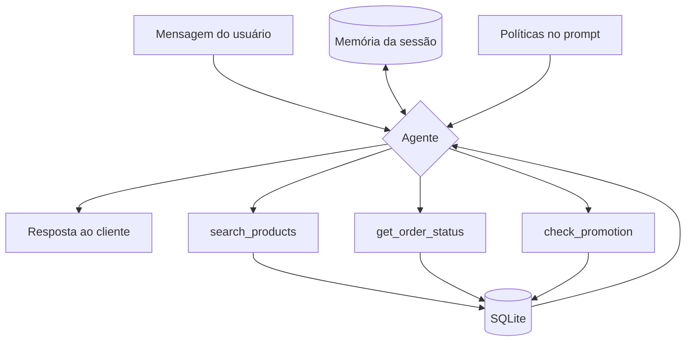

# Agente de Atendimento - Empório da Música

Protótipo de um agente de atendimento para a Empório da Música, loja fictícia de instrumentos musicais. O agente responde dúvidas de clientes sobre catálogo, preços, pedidos, promoções e políticas da loja, consultando dados reais e aplicando as regras do manual de atendimento.

## Arquitetura



O agente recebe a mensagem com o histórico da sessão (memória) e as políticas da loja fixas no prompt. Ele decide entre responder direto, para saudações, dúvidas de política ou itens fora de escopo, ou chamar uma das três ferramentas de consulta, que leem o banco SQLite. O resultado volta ao agente, que redige a resposta final.

## Como rodar

**Pré-requisitos:** Python 3.10+ e uma chave de API da Groq (gratuita em console.groq.com).

```bash
# 1. clonar e entrar na pasta
git clone https://github.com/[seu-usuario]/emporio-agente.git
cd emporio-agente

# 2. ambiente virtual
python -m venv venv
source venv/Scripts/activate      # Windows (Git Bash)
# source venv/bin/activate         # Linux/Mac

# 3. dependências
pip install -r requirements.txt

# 4. configurar a chave
# criar um arquivo .env na raiz com:
# GROQ_API_KEY=gsk_sua_chave_aqui

# 5. carregar os dados no banco
python data/load_data.py

# 6. rodar o agente
python main.py
```

## Decisões técnicas

**Abordagem: function calling, sem framework.** Optei por function calling puro com o SDK da Groq, em vez de RAG ou de um framework de agentes. Dois motivos: (1) os dados cabem folgado no contexto, os CSVs e o manual de políticas somam poucos milhares de tokens, então indexação vetorial seria complexidade sem ganho; (2) manter o laço do agente escrito à mão me dá controle total e demonstra o entendimento da mecânica, em vez de delegar a orquestração a uma abstração maior que o problema.

**Dados estruturados em SQLite, políticas no prompt.** As consultas de catálogo, pedido e promoção são relacionais e com filtro (preço, estoque, categoria), então uso SQLite com SQL parametrizado, mais preciso que busca semântica para esse tipo de pergunta. Já o manual de políticas é texto curto e estável, então fica fixo no prompt do sistema, carregado de um arquivo `policies.md` em tempo de execução (a equipe pode editar as políticas sem tocar no código).

**Separação entre dado e política.** A regra central do agente: dados (preço, estoque, disponibilidade) vêm sempre das ferramentas; políticas vêm do manual. O agente nunca afirma preço ou estoque sem consultar o banco.

**Modelo:** `openai/gpt-oss-120b` via Groq. Escolhi um modelo grande por lidar melhor com a decisão de qual ferramenta chamar e com que argumentos, a parte mais sensível de um agente de function calling. Modelos menores erram mais nessa escolha (ex: usar o filtro de texto no lugar do de categoria), o que gera resposta errada mesmo com os dados certos no banco.

**Ferramentas:** três funções de consulta — `search_products` (catálogo, com filtros), `get_order_status` (pedido por código de rastreio) e `check_promotion` (promoção ativa). A busca de pedido é feita **apenas por código de rastreio**, nunca por nome, por privacidade (LGPD); e `check_promotion` filtra `is_active`, para o agente nunca anunciar desconto expirado.

**Interface:** CLI. O enunciado indica que o foco é o agente funcionando, não a interface, então um CLI entrega interação real com o mínimo de código acessório.

**Memória:** histórico de conversa por sessão, para o agente resolver referências entre turnos. Demonstrado no exemplo de memória, em que o cliente pergunta "o mais barato tem em estoque?" e o agente entende que se refere aos violões do turno anterior, sem o cliente repetir. Não persiste entre sessões.

## Suposições

O enunciado pede para documentar interpretações onde a informação é ambígua:

- **Dois telefones no manual.** O manual traz (67) 3341-4444 no cabeçalho e (67) 3321-4500 na seção de WhatsApp. Assumi o 3341-4444 por aparecer em dois lugares contra um.
- **"Mais de 300 instrumentos".** O manual cita esse número, mas o catálogo real tem 65 produtos. Tratei número de catálogo como dado do banco, nunca do texto institucional, o agente é instruído a não citar quantidades vindas do manual.

## Limitações conhecidas

- **Memória de sessão, não persistente.** Fecha o programa, perde o histórico. Para persistir entre sessões seria preciso identificar o cliente (mesma questão de privacidade do pedido por nome) e serializar os objetos de mensagem. Fora do escopo de um protótipo; seria o próximo passo.
- **Contexto cresce sem limite.** A cada turno o histórico aumenta, incluindo resultados de ferramenta. Em conversas longas isso pode estourar o limite de tokens. Com mais tempo: cortar turnos antigos mantendo o system, ou resumir o histórico.
- **Busca textual simples.** Uso `LIKE` no nome e na categoria, não entende sinônimo nem erro de digitação ("violao" sem til). Adequado para o volume, mas não é busca semântica.

## Uso de assistentes de código

- Usei o Claude como par técnico ao longo do projeto, não como gerador de código a copiar.
- Desenhei a arquitetura antes de codar e questionei as escolhas:
  - avaliei RAG e descartei (dados cabem no contexto);
  - avaliei CrewAI e optei por function calling puro;
  - defini o padrão de nomenclatura (código em inglês, conteúdo do cliente em português);
  - defini o padrão de commits (Conventional Commits).
- Depuração baseada em evidência: ao testar, o agente respondeu que não havia
  ukuleles quando havia; investiguei e descobri que o modelo usava o filtro de
  texto em vez do de categoria (a palavra "ukulele" não aparece nos nomes dos
  produtos, só na categoria); corrigi expondo as categorias no schema e tornando
  a busca textual também sensível à categoria.
- Testei as ferramentas função a função antes de integrar ao agente.

## Estrutura

```
├── agent/
│   ├── tools.py    # as três ferramentas + schemas
│   ├── prompt.py   # persona, regras e políticas
│   ├── loop.py     # laço de function calling
│   └── memory.py   # histórico de conversa
├── data/           # CSVs, policies.md, load_data.py → store.db
├── examples/       # conversas de exemplo
├── main.py         # CLI
└── README.md
```
