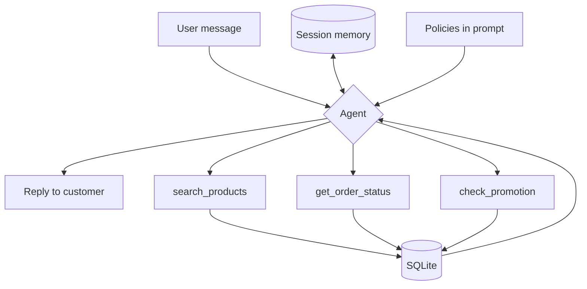

# Customer Support Agent — Empório da Música

Prototype of a customer support agent for Empório da Música, a fictional musical instruments store. The agent answers customer questions about the catalog, prices, orders, promotions, and store policies, querying real data and applying the rules from the support manual. The agent itself replies to customers in Portuguese, since that is the store's language; this documentation is in English.

## Architecture



The agent receives the message along with the session history (memory) and the store policies, which are fixed in the system prompt. It decides whether to answer directly — for greetings, policy questions, or out-of-scope requests — or to call one of the three query tools, which read the SQLite database. The result returns to the agent, which writes the final reply.

## How to run

**Requirements:** Python 3.10+ and a Groq API key (free at console.groq.com).

```bash
# 1. clone and enter the folder
git clone https://github.com/maysaraujo/emporio-agente.git
cd emporio-agente

# 2. virtual environment
python -m venv venv
source venv/Scripts/activate      # Windows (Git Bash)
# source venv/bin/activate         # Linux/Mac

# 3. dependencies
pip install -r requirements.txt

# 4. configure the key
# create a .env file in the root with:
# GROQ_API_KEY=gsk_your_key_here

# 5. load the data into the database
python data/load_data.py

# 6. run the agent
python main.py
```

## Technical decisions

**Approach: function calling, no framework.** I chose plain function calling with the Groq SDK, rather than RAG or an agent framework. Two reasons: (1) the data fits comfortably in the context — the CSVs and the policy manual add up to a few thousand tokens, so vector indexing would be complexity without benefit; (2) writing the agent loop by hand gives me full control and demonstrates an understanding of the mechanics, instead of delegating orchestration to an abstraction larger than the problem.

**Structured data in SQLite, policies in the prompt.** The catalog, order, and promotion queries are relational and filter-based (price, stock, category), so I use SQLite with parameterized SQL — more precise than semantic search for this kind of question. The policy manual, on the other hand, is short and stable text, so it stays fixed in the system prompt, loaded from a `policies.md` file at runtime (the team can edit the policies without touching the code).

**Separation between data and policy.** The agent's core rule: data (price, stock, availability) always comes from the tools; policies come from the manual. The agent never states a price or stock level without querying the database.

**Model:** `openai/gpt-oss-120b` via Groq. I chose a large model because it handles the decision of which tool to call, and with which arguments, better — the most sensitive part of a function-calling agent. Smaller models make more mistakes in that choice (e.g., using the text filter instead of the category filter), producing a wrong answer even when the database holds the right data.

**Tools:** three query functions — `search_products` (catalog, with filters), `get_order_status` (order by tracking code), and `check_promotion` (active promotion). Order lookup is done **by tracking code only**, never by name, for privacy reasons (LGPD); and `check_promotion` filters `is_active`, so the agent never announces an expired discount.

**Interface:** CLI. The brief states that the focus is the working agent, not the interface, so a CLI delivers real interaction with the least amount of accessory code.

**Memory:** per-session conversation history, so the agent can resolve references across turns. Demonstrated in the memory example, where the customer asks "is the cheapest one in stock?" and the agent understands it refers to the guitars from the previous turn, without the customer repeating. It does not persist across sessions — see limitations.

## Assumptions

The brief asks to document interpretations where information is ambiguous:

- **Two phone numbers in the manual.** The manual lists (67) 3341-4444 in the header and (67) 3321-4500 in the WhatsApp section. I assumed 3341-4444, as it appears in two places against one.
- **"More than 300 instruments".** The manual cites this number, but the real catalog has 65 products. I treated the catalog count as database data, never institutional text — the agent is instructed not to cite quantities coming from the manual.

## Known limitations

- **Session memory, not persistent.** Close the program and the history is lost. Persisting across sessions would require identifying the customer (the same privacy concern as order-by-name) and serializing the message objects. Out of scope for a prototype; it would be the next step.
- **Context grows without bound.** Each turn adds to the history, including tool results. In long conversations this can exceed the token limit. With more time: trim old turns while keeping the system message, or summarize the old history.
- **Simple text search.** I use `LIKE` on the name and category — it does not handle synonyms or typos ("violao" without the accent). Adequate for the volume, but not semantic search.

## Use of code assistants

- I used Claude as a technical pair throughout the project, not as a code generator to copy from.
- I designed the architecture before coding and questioned the choices:
  - evaluated RAG and discarded it (the data fits in the context);
  - evaluated CrewAI and chose plain function calling;
  - defined the naming convention (code in English, customer-facing content in Portuguese);
  - defined the commit convention (Conventional Commits).
- Evidence-based debugging: while testing, the agent answered that there were no ukuleles when there were; I investigated and found the model was using the text filter instead of the category filter (the word "ukulele" does not appear in product names, only in the category); I fixed it by exposing the categories in the schema and making the text search also match the category.
- I tested the tools function by function before integrating them into the agent.

## Structure

```
├── agent/
│   ├── tools.py    # the three tools + schemas
│   ├── prompt.py   # persona, rules and policies
│   ├── loop.py     # function-calling loop
│   └── memory.py   # conversation history
├── data/           # CSVs, policies.md, load_data.py → store.db
├── examples/       # example conversations
├── main.py         # CLI
└── README.md
```
